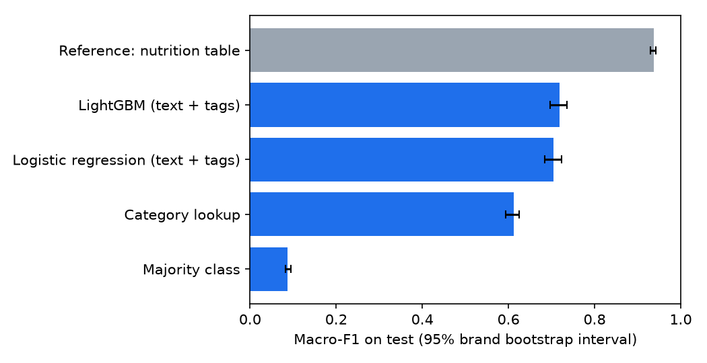
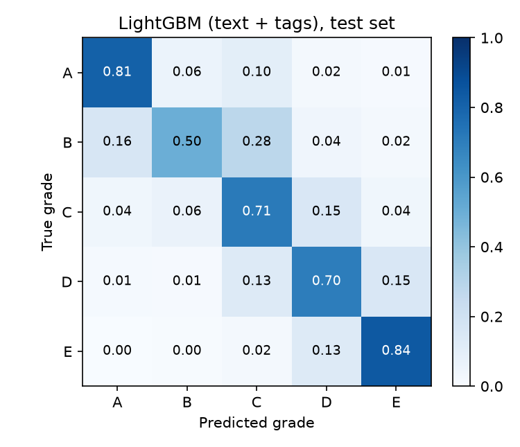
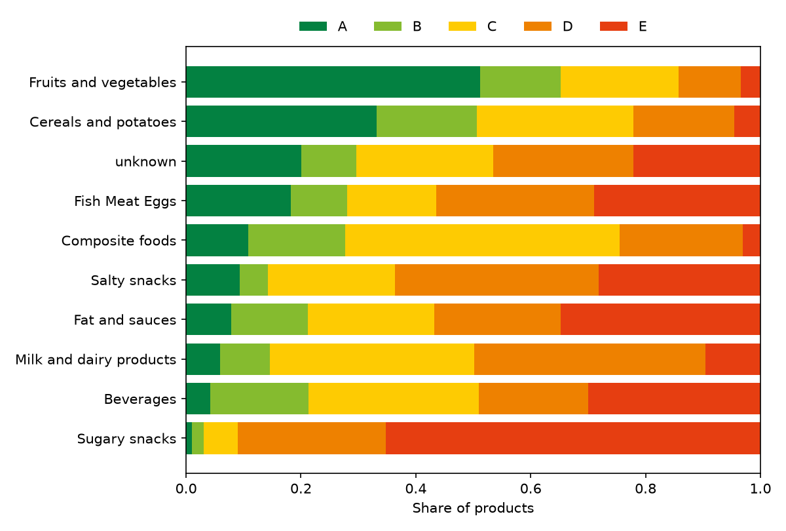
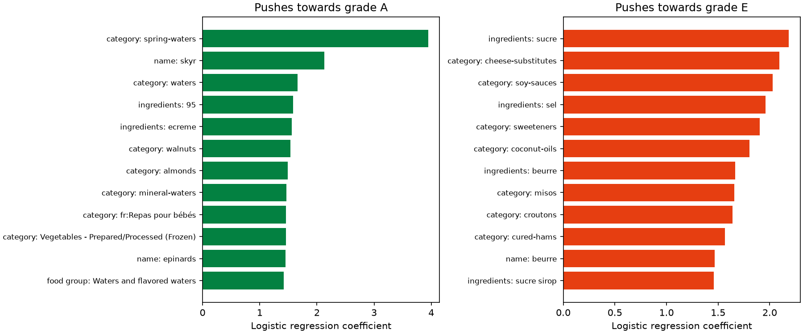
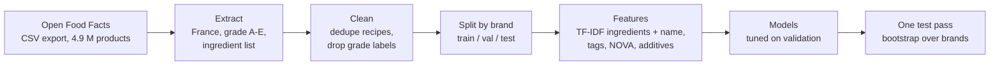

# Estimating the Nutri-Score without a nutrition table

[](https://github.com/jordanT667/nutriscore-ml/actions/workflows/tests.yml) 

Many products in [Open Food Facts](https://world.openfoodfacts.org) have an ingredient list and a category but no nutrition table, so no Nutri-Score can be computed for them. This project asks a simple question: **how well can the grade (A to E) be estimated from what is still available, the ingredients, the product name, the categories, additives and labels?**

Predicting the Nutri-Score *from* the nutrition table would only re-learn a published formula. Here the nutrition table is never given to the model; it is used only as a reference to show what is lost without it.

<p align="center">
  
</p>

## Results

Test set: 44,188 French products from brands never seen during training. Each model was tuned on a separate validation set, and the test set was evaluated once.

| Model | Macro-F1 [95% interval] | Accuracy | Within one grade | Mean grade error | Quadratic kappa |
|---|---|---|---|---|---|
| Majority class | 0.087 [0.082, 0.094] | 0.278 | 0.530 | 1.58 | 0.000 |
| Category lookup | 0.612 [0.593, 0.625] | 0.636 | 0.876 | 0.53 | 0.742 |
| Logistic regression (text + tags) | 0.705 [0.683, 0.723] | 0.726 | 0.939 | 0.35 | 0.856 |
| **LightGBM (text + tags)** | **0.719 [0.697, 0.736]** | **0.738** | **0.945** | **0.33** | **0.864** |
| *Reference: nutrition table* | *0.938 [0.930, 0.943]* | *0.949* | *0.993* | *0.06* | *0.979* |

- **Category lookup is the baseline to beat.** Predicting the most frequent grade of the product's most specific category already reaches a macro-F1 of 0.61: sugary snacks are mostly E, fruit and vegetables mostly A.
- **Reading the ingredients adds about 0.11 macro-F1** over that baseline (LightGBM: +0.107, 95% interval [0.097, 0.116], paired bootstrap over brands). The selected model is right within one grade for 94.5% of products.
- **Logistic regression and LightGBM are close.** Their intervals overlap, and the linear model is much easier to explain.
- **The nutrition table is still worth a lot**: with it, the macro-F1 reaches 0.94. The model narrows the gap between "no information" and "full table", it does not close it.

<p align="center">
  
  
</p>

Errors are mostly between neighbouring grades. Grade **B** is the hardest (50% recall, 28% predicted as C). By food family, the model does best on dairy products (macro-F1 0.75) and worst on composite foods such as ready meals (0.55), where the ingredient list says little about the proportions ([per-family results](reports/results/test_by_family.csv)).

### What the model reads

<p align="center">
  
</p>

The linear model's strongest signals match nutrition common sense: *sucre*, *sel*, *beurre* and categories such as cured hams or croutons push towards E; waters, nuts, spinach and skimmed (*écrémé*) products push towards A. Some signals are artefacts of how ingredient lists are written, for example the token *95*, which comes from percentages such as "95 %".

## Method



| Step | Choice | Why |
|---|---|---|
| Data | Open Food Facts export of 16 Nov 2026, 4,916,182 rows read in chunks; 278,131 French products with a grade and an ingredient list | The export is ~10 GB uncompressed, so only the needed columns are kept |
| Cleaning | Duplicate codes and identical (name, ingredients) recipes removed: 265,691 products | The same recipe sold under several barcodes would inflate the scores |
| Leakage | Labels such as `nutriscore-grade-a` removed; the nutrition table and the score never reach the model; checked by unit tests | These would give the answer away |
| Split | 180,773 / 40,730 / 44,188 products, **grouped by brand** (57,054 brands) | Products of one brand share recipes; a random split would overestimate the scores |
| Features | Word TF-IDF (1-2 grams) on ingredients and name, binary tags (categories, ingredients, additives, labels, food groups), NOVA group, additive count: 158,242 columns | Everything a product page shows without its nutrition table |
| Tuning | Logistic regression: 6 configurations; LightGBM: early stopping (224 rounds) | All on the validation set |
| Evaluation | Macro-F1 (grades are imbalanced), within-one-grade accuracy, quadratic kappa (grades are ordered), 1,000 bootstrap resamples **of brands** | Intervals match the unit of the split |

## Try it

A small web demo estimates the grade from what a visitor can type: product name, ingredient list and food group. It shows the probability of each grade and the terms that pushed the estimate.

```bash
streamlit run app.py
```

```bash
python -m src.nutriscore.predict "sucre, farine de blé, huile de palme, chocolat" --name "biscuits fourrés" --group "Biscuits and cakes"
```

The demo cannot ask for Open Food Facts tags, so it uses its own model ([`demo_model.py`](src/nutriscore/demo_model.py)): a logistic regression on those three fields only, tuned on the validation set and evaluated once on the same test set.

| Model | Inputs | Macro-F1 | Within one grade |
|---|---|---|---|
| LightGBM (project result) | text and all tags | 0.719 | 0.945 |
| **Demo model** | name, ingredients, food group | **0.677** | **0.925** |

The demo model file (`demo/model.joblib`, 6.5 MB) is stored in the repository so the demo runs without the 1.5 GB export.

## Limits

- **Evaluated on products that do have a table.** The grade is only known for those, so the products that really lack a table may differ (for example more small producers), and the scores may be lower on them.
- **Crowd-sourced data.** Open Food Facts entries contain errors in categories and ingredient lists; no manual correction was made.
- **France only**, with ingredient lists mostly in French.
- **Grades as computed by Open Food Facts**; the version of the Nutri-Score algorithm behind them was not checked product by product.
- An estimate is not an official Nutri-Score and must not be displayed as one.

## Run it

Python 3.13. The raw export is 1.5 GB and is not stored in this repository.

```bash
pip install -r requirements.txt
curl -L -o data/raw/en.openfoodfacts.org.products.csv.gz https://static.openfoodfacts.org/data/en.openfoodfacts.org.products.csv.gz
python -m src.nutriscore.extract    # -> data/interim/products_fr.parquet
python -m src.nutriscore.prepare    # -> cleaned table with the brand split
python -m src.nutriscore.explore    # -> descriptive statistics
python -m src.nutriscore.train      # -> reports/results, reports/figures, models/
python -m pytest
```

All metrics above come from [`reports/results/`](reports/results). Random seed: 42. A new export will give slightly different numbers, as the database changes every day.

## Project structure

```
src/nutriscore/
  extract.py    stream the CSV export, keep French products with a grade
  prepare.py    clean, deduplicate, remove leaking labels, split by brand
  explore.py    descriptive statistics and the grades-by-family figure
  features.py   feature pipeline (no nutrition table)
  train.py      baselines, models, validation, single test pass, figures
  demo_model.py the smaller model behind the demo
  predict.py    one prediction with the terms behind it
app.py          Streamlit demo
demo/           demo model file
tests/          leakage, split, prediction and demo tests
reports/        metrics (JSON, CSV) and figures
```

## Data and licence

Data: [Open Food Facts](https://world.openfoodfacts.org), under the [Open Database License (ODbL)](https://opendatacommons.org/licenses/odbl/1-0/). Nutri-Score is a front-of-pack label recommended by Santé publique France.
